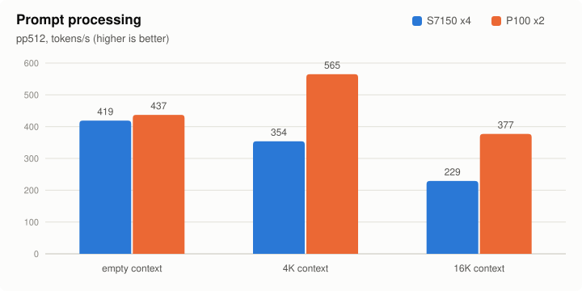
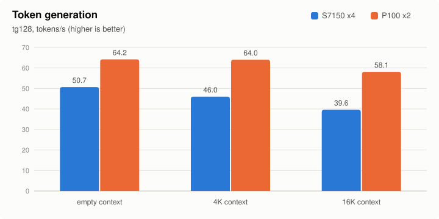
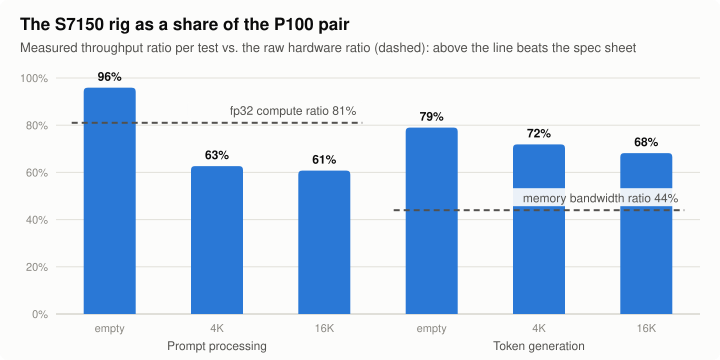

# llama.cpp for AMD FirePro S7150 (GCN3)

This is a fork of [ggml-org/llama.cpp](https://github.com/ggml-org/llama.cpp) tuned for the Vulkan backend on
**AMD FirePro S7150 / S7150 x2** cards (Tonga, GCN3, 8 GB GDDR5 per GPU) using Mesa's RADV driver. It makes
tensor-parallel inference across several of these GPUs (`-sm tensor`) fast. The tracked branch is
[`r720-vk-tensor-split`](https://github.com/pcbjunkie/llama.cpp-radeon-firepro/tree/r720-vk-tensor-split). It is kept in sync with upstream, and upstream's own
README follows below this section.

## Why this fork exists

The S7150 is an old datacenter card that sells used for very little. On paper it is not far behind cards that
cost several times more, but upstream llama.cpp leaves most of that on the table on GCN3. That isn't upstream's
fault: the Vulkan backend is tuned for current GPUs, and some of its patterns hit specific weaknesses of this
generation and of the old Mesa versions that still support it well, such as loops that Mesa 22.3 does not
unroll, subgroup shuffles that turn into slow LDS round trips, scalar-cache thrashing and loads serialized
behind branches. This fork fixes those, and adds kernels shaped for how these GPUs actually behave.

## Who it's for

- Anyone running LLMs on **cheap, used AMD GCN3 hardware** (FirePro S7150 / S7150 x2 and, likely, other Tonga
  and Fiji parts) who wants the most out of it.
- Home-lab and budget builders who care about **tokens per dollar** more than tokens per watt.
- Multi-GPU setups in **old servers** (PCIe 3.0, no peer-to-peer), where the GPUs exchange data through host
  memory.

## Benchmarks

Qwen3-30B-A3B, Q4_K_M, flash attention on, `llama-bench -p 512 -n 128 -d 0,4096,16384`.

| | S7150 rig | P100 rig |
|---|---|---|
| GPUs | 4x FirePro S7150 (two S7150 x2 boards), Vulkan / RADV (Mesa 22.3) | 2x Tesla P100 PCIe 16 GB, CUDA (stock upstream) |
| Split | `-sm tensor -ts 1/1/1/1` | `-sm tensor` |
| Host | Dell R720, dual Xeon | dual Xeon |

<picture>
  <source media="(prefers-color-scheme: dark)" srcset=".github/firepro/prompt-dark.svg">
  
</picture>

<picture>
  <source media="(prefers-color-scheme: dark)" srcset=".github/firepro/decode-dark.svg">
  
</picture>

| test | 4x S7150 (this fork) | 2x P100 (upstream CUDA) | S7150 / P100 |
|---|---:|---:|---:|
| pp512 | 419 | 437 | **96%** |
| pp512 @ 4K | 354 | 565 | 63% |
| pp512 @ 16K | 229 | 377 | 61% |
| tg128 | 50.7 | 64.2 | **79%** |
| tg128 @ 4K | 46.0 | 64.0 | **72%** |
| tg128 @ 16K | 39.6 | 58.1 | **68%** |

Tokens/s, higher is better. P100 token generation was measured as tg64.

### Beating the spec sheet

By raw hardware, four S7150s have about **81%** of the fp32 compute of two P100s (4 x 3.77 vs 2 x 9.3
TFLOPS) and only **44%** of their memory bandwidth (4 x 160 vs 2 x 732 GB/s). The measured results beat both
ratios:

- **Prompt processing at short context reaches 96%** of the P100 pair, above the 81% compute ratio.
- **Token generation reaches 68-79%** of the P100 pair, far above the 44% bandwidth ratio that usually
  limits it.

<picture>
  <source media="(prefers-color-scheme: dark)" srcset=".github/firepro/ratio-dark.svg">
  
</picture>

Long-context prompt processing (61-63%) is the one place still below its hardware ratio. The P100 runs
attention at double-rate fp16, which GCN3 lacks, so a register-tiled attention kernel is the next step there.

Cost matters too: S7150 x2 boards sell used for a fraction of what a pair of P100s goes for, so per dollar the
S7150 rig comes out well ahead. Per watt it does not.

## Fixes and optimizations

Starting point: this fork's first working tensor split on the S7150s, which ran at **pp512 296 / 190 / 94** and
**tg 43.9 / 39.8 / 31.8** tokens/s (empty / 4K / 16K context). Each line below lists what changed and what it
was measured to do. Kernel times are per GPU, per call. Some changes were measured together, and the table says
so where they were.

| change | before | after |
|---|---|---|
| **Prompt attention:** new kernel (`local_fa_prefill.comp`) where one workgroup takes 4 tokens x all query heads of a kv head, so K/V are read once for all of them; Q in shared memory, 2 keys per lane, fully masked chunks skipped | 33.0 ms per call (16K keys x 512 rows); pp512 @ 16K 184, @ 4K 325 | 21.4 ms; pp512 @ 16K **229**, @ 4K **354** |
| **Prompt attention, stock shader** (`flash_attn.comp`): unrollable split-sum loop (Mesa 22.3 doesn't unroll shift-induction loops), clustered subgroup adds instead of shuffles, 8 x 128 GCN block | 74 ms per call (16K x 512) | 40 ms |
| **Decode attention:** new kernel (`local_fa_decode4.comp`), query heads of a kv head share a K tile in shared memory; split combine without branch-sunk loads | 150 us per call (16K keys); tg @ 16K 31.8 | 103 us; tg @ 16K 35.1 |
| **Decode attention:** 8 waves of one head each, one split per CU (measured inside the model, not in isolation) | 38 / 96 / 143 us per call (empty / 4K / 16K) | 31 / 71 / 134 us |
| **MoE top-k:** expert selection with two subgroup reductions (DPP) instead of a shuffle butterfly (`ds_bpermute` per step on GCN); same experts, same tie rule | 21.5 us per call; tg 49.6 | 15.3 us; tg **51.0** |
| **MoE expert path:** down projection + weights + sum fused into one kernel (q4_K), peers polled in parallel in the all-reduce, flag lines tuned (measured together) | tg 46.5 | tg 48.3 |
| **All-reduce flag lines:** 64-byte lines instead of 128 (GCN3 cache line) | flag write 11 us per round; tg 48.2 | 7.5 us; tg 49.1 |
| **All-reduce for prompts:** q8 data on the wire, staged in VRAM | pp512 365 | pp512 400 |
| **MoE prompt matmul:** GCN medium `mmqid` warptile 256 x 64 x 64 | pp512 401 | pp512 413 |
| **Chip power limit** raised from 81 W to 100-110 W through a runtime PowerPlay table, no VBIOS flash ([firepro-power](https://github.com/pcbjunkie/firepro-power)); prompt processing was power-capped at ~849 MHz, decode never was | pp512 / pp512 @ 16K at 81 W | +12% / +22% at 100 W |

Things that were tried and measured slower stay off by default: router matvec + top-k in one kernel
(`LOCAL_VK_ROUTER_TOPK=1`), Q staged in shared memory for decode attention, early V loads, other prefill tile
shapes.

Output quality is unchanged: perplexity 5.0350 ± 0.115 with the new attention kernels, against 5.0451 with
the stock ones. All backend op tests pass.

## Usage

Build as usual with Vulkan (`cmake -B build -DGGML_VULKAN=ON && cmake --build build -j`), then run with the
GPUs in tensor split:

```
llama-server -m Qwen3-30B-A3B-Q4_K_M.gguf -ngl 99 -fa 1 -sm tensor -ts 1/1/1/1
```

Notes:

- Tested on Debian 12, kernel 6.1, Mesa 22.3.6 (RADV), amdgpu driver. Other GCN3/GCN4 cards should work but are
  untested.
- The prompt numbers above are at a 110 W chip limit with clocks pinned high, set with
  [firepro-power](https://github.com/pcbjunkie/firepro-power) (runtime PowerPlay table, no VBIOS flash). At
  the stock 81 W limit, prompt processing is roughly 10-20% slower. Token generation is unaffected.
- Every new kernel has an off switch (`LOCAL_VK_FA_PREFILL=0`, `LOCAL_VK_FA4=0`, `LOCAL_VK_FA4_H1=0`,
  `LOCAL_VK_NO_MMID_SUM=1`, `LOCAL_VK_COMM_Q8=0`) for comparison or troubleshooting.
- `GGML_VK_PERF_LOGGER=1` prints per-op GPU timings. In `llama-bench` only the measured runs are logged.
- With `-sm tensor`, greedy output can differ slightly from upstream's kernels: the summation order in
  attention changed. `-sm layer` output is unchanged.

---

# llama.cpp


<div align="center">

<b>LLM inference in C/C++</b>

[](https://opensource.org/licenses/MIT)
[](https://github.com/ggml-org/llama.cpp/releases?q=tag:v1)
[](https://github.com/ggml-org/llama.cpp/releases?q=b)
[](https://github.com/ggml-org/llama.cpp/actions/workflows/server.yml)
[](https://github.com/ggml-org/llama.cpp/actions/workflows/docker.yml)
[](https://github.com/ggml-org/llama.cpp/actions/workflows/winget.yml)

[v1.0.0](https://huggingface.co/blog/ggml-org/llama-cpp-v1) / [ggml](https://github.com/ggml-org/ggml) / [ops](https://github.com/ggml-org/llama.cpp/blob/master/docs/ops.md) / [maintainer PRs](https://github.com/ggml-org/llama.cpp/pulls?q=is%3Apr%20is%3Aopen%20draft%3AFalse%20(author%3Asanmai%20OR%20author%3Argerganov%20OR%20author%3AKitaitiMakoto%20OR%20author%3Adanbev%20OR%20author%3Aaldehir%20OR%20author%3Amax-krasnyansky%20OR%20author%3ACISC%20OR%20author%3Aggerganov%20OR%20author%3Aam17an%20OR%20author%3Ajhen0409%20OR%20author%3Abartowski1182%20OR%20author%3Anikwen%20OR%20author%3Ahipudding%20OR%20author%3Aravi9%20OR%20author%3AServeurpersoCom%20OR%20author%3Athelittlefireman%20OR%20author%3Apwilkin%20OR%20author%3Areeselevine%20OR%20author%3Angxson%20OR%20author%3Ajeffbolznv%20OR%20author%3Amarty1885%20OR%20author%3A0cc4m%20OR%20author%3ATitaniumtown%20OR%20author%3Aangt%20OR%20author%3AIMbackK%20OR%20author%3Aarthw%20OR%20author%3AJohannesGaessler%20OR%20author%3AORippler%20OR%20author%3Aruixiang63%20OR%20author%3Axctan%20OR%20author%3AmasterFoad%20OR%20author%3Aallozaur%20OR%20author%3AAndreas-Krebbel%20OR%20author%3Ayomaytk%20OR%20author%3Aaendk%20OR%20author%3Awine99%20OR%20author%3Agaugarg-nv%20OR%20author%3Ataronaeo%20OR%20author%3Aforforever73%20OR%20author%3Achaxu01%20OR%20author%3Alhez%20OR%20author%3AAlekseiNikiforovIBM%20OR%20author%3Anetrunnereve%20OR%20author%3Afairydreaming%20OR%20author%3Aynankani)%20sort%3Aupdated-desc) / [dev stats](https://github.com/ggml-org/llama.cpp-dev) / [lib llama API](https://github.com/ggml-org/llama.cpp/issues/9289) / [llama-server REST API](https://github.com/ggml-org/llama.cpp/issues/9291)

</div>

## Description

The main goal of `llama.cpp` is to enable LLM (and MLLM) inference with minimal setup and state-of-the-art performance on a wide range of hardware - locally and in the cloud.

The `llama.cpp` project is built on top of the [ggml](https://github.com/ggml-org/ggml) library.

## Quick start

A few options to get `llama.cpp` installed on your machine:

```bash
# curl
curl -LsSf https://llama.app/install.sh | sh

# powershell
irm https://llama.app/install.ps1 | iex
```

- Visit https://llama.app and follow the instructions
- Run with Docker - see our [Docker documentation](docs/docker.md)
- Download pre-built binaries from the [releases page](https://github.com/ggml-org/llama.cpp/releases)
- Build from source by cloning this repository - check out [our build guide](docs/build.md)

Once installed:

```sh
# Download and run a model directly from Hugging Face
llama cli -hf ggml-org/Qwen3.5-0.8B-GGUF

# Launch OpenAI-compatible API server
llama serve -hf ggml-org/Qwen3.5-0.8B-GGUF
```

<table align="center">
    <tr>
        <td align="center" width=50%>
            
            <i>VLM session with <b>llama cli</b></i>
        </td>
        <td align="center">
            
            <i>Llama Chat, the built-in chat app, against <b>llama serve</b></i>
        </td>
    </tr>
<table>

## Documentation

#### Tools

- [cli](tools/cli/README.md)
- [completion](tools/completion/README.md)
- [server](tools/server/README.md)
- [Text-to-speech (TTS) models](docs/multimodal/tts.md)
- [GBNF grammars](grammars/README.md)

#### Development

- [How to build](docs/build.md)
- [Running on Docker](docs/docker.md)
- [Build on Android](docs/android.md)
- [Multi-GPU usage](docs/multi-gpu.md)
- [Performance troubleshooting](docs/development/token_generation_performance_tips.md)
- [GGML tips & tricks](https://github.com/ggml-org/llama.cpp/wiki/GGML-Tips-&-Tricks)
- [XCFramework](docs/xcframework.md)
- [Completions](docs/completions.md)
- [Models](docs/models.md)
- [Release process](docs/release.md)

## Contributing

- Contributors can open PRs
- Collaborators will be invited based on contributions
- Maintainers can push to branches in the `llama.cpp` repo and merge PRs into the `master` branch
- Any help with managing issues, PRs and projects is very appreciated!
- Read the [CONTRIBUTING.md](CONTRIBUTING.md) for more information

## Acknowledgements

- [yhirose/cpp-httplib](https://github.com/yhirose/cpp-httplib) - Single-header HTTP server, used by `llama-server` - MIT license
- [nothings/stb](https://github.com/nothings/stb) - Single-header image format decoder, used by multimodal subsystem - Public domain
- [nlohmann/json](https://github.com/nlohmann/json) - Single-header JSON library, used by various tools/examples - MIT License
- [mackron/miniaudio](https://github.com/mackron/miniaudio) - Single-header audio format decoder, used by multimodal subsystem - Public domain
- [sheredom/subprocess.h](https://github.com/sheredom/subprocess.h) - Single-header process launching solution for C and C++ - Public domain
